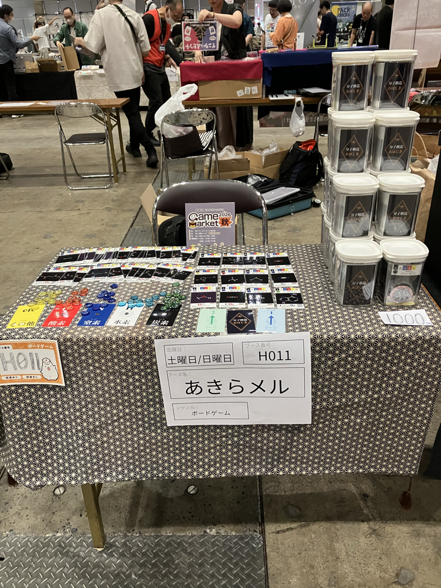
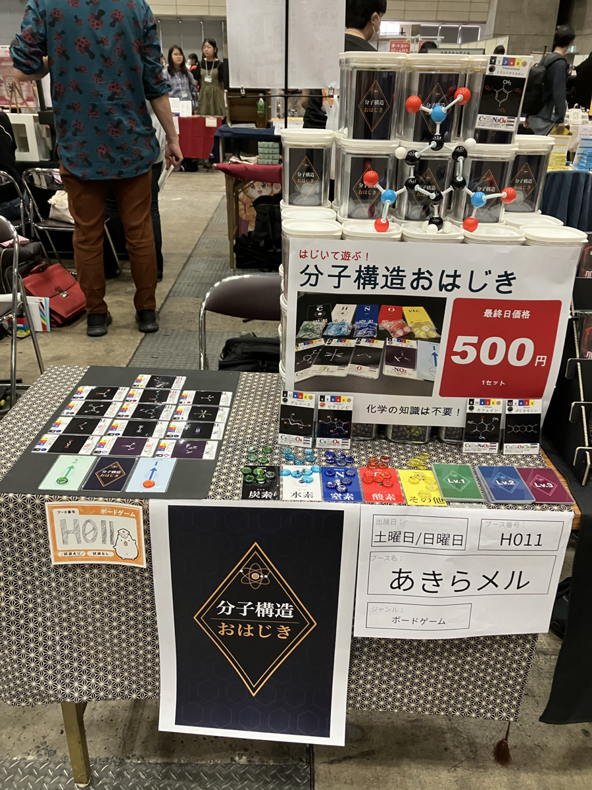

# ゲームマーケット2026秋 一般出展レポート
## 〜0.1秒を1秒に変えた日曜日〜

**分子構造おはじきゲーム** 制作・出展者による参加記録（2026年10月）

---

## はじめに

ゲームマーケット2026秋（10月17日・18日、幕張メッセ）に、今回は「一般出展・半卓・両日」（ブース番号 H011）で出展しました。春はチャック横丁で日曜のみの出展だったので、2回目の出展であり、初めての一般枠・初めての2日間です。

結果から書くと、**土曜日は9セット、日曜日は45セット**でした。同じ商品、同じ人間、同じ場所で、1日違うだけでこれだけ変わりました。

このレポートは、ゲームマーケットへの出展を考えている方、そして「どうすれば売れるのか」を悩んでいる方の参考になればと思って書きました。春のレポートと同じく、失敗も含めて正直に書きます。

前回のレポートはこちらです：[ゲームマーケット2026春 初出展レポート 〜30kgの分子を運んだ日〜](./gamemarket_2026spring_report.md)

---

## 今回の背景：準備がほとんどできなかった

今回は、翌週に勤務先の研究所の一般公開が控えていたため、ゲームマーケットの準備に時間を割けませんでした。

- **品物は用意できた**（これだけは間に合った）
- X（Twitter）での事前宣伝：**できなかった**
- YouTubeへのプレイ動画アップ：**できなかった**
- ポスター・旗などの販促物：**ほぼゼロ**
- パンフレット（カタログ）の広告：期限内に提出でき、掲載された（春に逃した反省は活かせました）

この「準備不足」が、土曜日の結果にそのまま出ることになります。

---

## 春からの変更点：パッケージと価格

### 容器と巾着袋

春はチャック横丁で「チャック袋に入れる」というルールがあったため、ジップロックのような袋で販売しました。今回は制限がないので、見栄えを上げるために次の変更をしました。

- ジップロック → **DAISOの密閉容器**（110円）
- ゲームに必要な**巾着袋**を追加（110円）。ワンちゃんやシマエナガのイラスト入りと、無地の数種類を用意

### 価格設計

| | 春 | 秋（計画） |
|---|---|---|
| 製造原価 | 約500円 | 約720円（+容器110円 +巾着110円） |
| 販売価格 | 500円 | 1,000円 |
| 1セットあたり利益（計画） | 約0円 | 約280円 |

「原価の2倍が目安」と言われるので、1,000円なら原価720円でも利益が出る、という計画でした。うまくいきませんでしたが。

### 費用

| 項目 | 金額 |
|------|------|
| 出展料（一般出展・半卓・両日） | 22,000円 |
| 交通費（往復） | 約2,000円以上 |
| 製造原価（約720円 × 100セット） | 約72,000円 |

出展料と交通費だけで約2万4千円です。100セット全部を1,000円で売り切ったとしても、利益はわずかです。「材料費と参加費は何とか回収できる」程度の計算で、もちろんこれは取らぬ狸の皮算用でした。

---

## 1日目（土曜日）：9セット

*土曜日のブース。風呂敷を敷いて商品を並べただけ。*

### 搬入

朝6時ごろ起きて、9時前には会場に着きました。荷物は全部は持って行かず、**約60セット（20kgほど）**にしました。春の30kgの3分の2で、これなら問題なく移動できました。計画は「土曜に60個持ち込み、日曜に追加で40個売って、合計100個」です。

### 実際に売れたのは9セット

売れたのは**9セット**。本当にガッカリしました。敗因は大きく4つあります。

### 敗因1：事前広告をしなかった

これが一番大きかったです。購入者は、**事前に欲しい商品をチェックして来ています**。特に土曜日はその傾向が強いです。

土曜日は11時から12時が**先行入場枠**、12時から一般入場という流れでした。先行枠は特別な料金を払って入る人たちなので、欲しいものが明確です。お目当てのブースに向かってダッシュする人の波で、それ以外のブースは目に入っていません。途中のブースには一瞥もくれずに走り去っていきます。**最初の1時間は何もできませんでした。**

また、「プレイ動画はありませんか？」と聞いてくる方もいました。**ルールを読むだけでは、ゲームの面白さは伝わらない**のだと実感しました。動画があれば、事前にチェックしてもらえたはずです。

### 敗因2：ブースに目を止めるものがなかった

準備ができなかったので、家から古い風呂敷のような布を持って行ってテーブルに敷き、それなりの見栄えは確保しました。しかしポスターも旗もなく、商品とおはじきとカードを並べただけです。

それだけだと、本当に目立ちません。体感として、歩いている人がブースを見てくれる時間は**0.1秒ほど**です。その間に何か魅力的なポイントを伝えないといけない。そのためにはポスターが一番です。

### 敗因3：声掛けが効かない、そして体力がない

声掛けもしましたが、ほとんどの人は素通りです。興味がないのに声をかけられても困るだけですよね。**声掛けでブースに近寄ってくれた人は、ゼロと言ってもいいくらい**でした。

さらに、前日は朝5時ごろまで商品の準備をしていたので、元気がなく、立って声をかけ続けることもできませんでした。**仕事などで忙しくても、前日はよく寝た方がいい**です。

### 敗因4：化粧箱（パッケージ）が必要だった

春は「チャック横丁」というルールがあったので化粧箱は要りませんでしたが、**一般出展では化粧箱は不可欠**です。

密閉容器で多少は見栄えが良くなりましたが、それだけでは1,000円は割高に感じられるようでした。1,000円台の商品は、周りにきれいにデザインされ、パッケージングされたものがごろごろしています。その中で手に取ってもらうには、それなりの見栄えが必要です。**そのレベルに達していなかった**、というのが正直なところです。

---

## 2日目（日曜日）：45セット

*日曜日のブース。値段付きA3ポスター、TNTの分子モデル、大きなタイトルポスターを追加。*

事前広告と化粧箱は今さら変えられません。それ以外でできる対策を、土曜の夜に考えて実行しました。

### 対策1：価格を500円に戻した

春と同じ**500円**にしました。

土曜日に1,000円で買ってくださった方には申し訳ないと思っています。ただ、**手作業で、業者に頼んでいないものに1,000円を払うのは、多くの人にとってボーダーライン以下**だったのだと思います。700円なら原価割れしない価格でしたが、100円玉をたくさん用意するのは間に合いませんでした。春の500円玉の残りがあったので、それを流用しました。

1セットあたり約200円の損失になります。ただ、在庫を家に置いておくと怒られますし、そもそもの目的は科学の楽しさを広めることなので、お金儲けは二の次でもあります。

土曜と日曜の両方に来る人は少ないようで、価格が変わったことに気づいて聞いてくる方はいませんでした。（土曜の購入者への対応は特にしていません。）

### 対策2：目が止まる工夫をした

- **A3プリントのポスター**を作成し、テーブルの前や商品の前に貼った
  - ゲーム名
  - **「500円」の値段**
  - **「化学の知識は必要ない」**
  - 商品写真をデカデカと
- **分子モデルのTNT**を用意して、そのカードと一緒に手に持った
- 春にも使った、**分子構造のラインストーン付き缶バッジが付いた帽子**をかぶった

### 結果：45セット

この2つの変更で、**日曜日は45セット**売れました。土曜の5倍です。

---

## 何が効いたのか

### 視線の時間：0.1秒 → 1秒

体感ですが、通行人がブースを見てくれる時間が、土曜の0.1秒から日曜は**1秒ほど**に伸びました。これは確実に違いがありました。

### 立ち止まる人：約20人 → 約100人

歩くのをやめてブースに寄ってくる人は、体感で**土曜は約20人、日曜は約100人**でした。かなり違います。

### 一番効いたのは「値段付きのポスター」

足を止める理由として、**値段付きのポスターが一番**でした。TNTの分子モデルを見て「高校や中学を思い出した」と話してくれた方もいました。

### 声掛けはタイミングがすべて

土曜と日曜で声掛けのやり方も変わりました。

- 見向きもしないで歩いている人に声をかけても、**99％うまくいかない**
- ポスターや分子モデルを見て**足を止めてくれた人**に声をかけるのが一番効果的
- もっと言えば、お客さんが**こちらに一歩踏み出してくれたら、ゲームの解説を勝手に始める**のが、いい感じでした

### セールスポイントは畳み掛ける

あれこれ試して分かったのは、セールスポイントを楽しく畳み掛けるのがよいということです。

- 「複数のゲームルールがあって、1人でも5人でも遊べますよ〜」
- 「カードは全部ラミネートされているんですよ〜」（そして全部手作業で、夜なべして作ったんですよ〜、というエピソードも添える）
- 「巾着袋は複数の柄を用意してて、今なら選び放題ですよ〜」（複数のワンちゃんの絵柄、シマエナガ、無地を、お客さんの前にずらずらと並べる）
- 「実は原価割れなんですよ〜」

### 巾着袋で一番人気だったのは、シマエナガ

巾着袋の中で一番人気だったのは、**シマエナガ**のイラストでした。やはり雪の妖精はかわいいようです。複数の柄から選べる、という楽しさも、手に取ってもらうきっかけになりました。

### 事前のカタログと、前回のレポート

パンフレットの広告は、効果があったかどうかは正直わかりません。一方で、**前回の「30kgの分子」のレポートを読んでくれた方**がブースに来てくれました。書いておいてよかった、と思った瞬間です。

---

## ブースの場所と、隣のブースとの会話

ブース番号は **H011**。企業ブースが通路の向こうにあり、通路はかなり広い位置でした。広い通路は、人が早足で通り過ぎやすいという面もあるように思います。（春は通路に近い場所の罠がありましたが、今回も似た印象でした。）

日曜日は説明に力を入れたので、終盤は喉が少しガラガラになりました。そんな時、近くの出展者さんが龍角散のタブレットを分けてくださり、本当にありがたかったです。春も喉がガラガラになったので、飴や水の常備は鉄則です。こういう助け合いが自然に生まれるのも、ゲームマーケットの良いところだと思います。

近所の出展者さんとも話をしました。その方によると、**「事前試遊会」や「対面ミーティング」はかなり効果的**だそうです。せっかくゲームマーケットに参加しているのですから、隣のブースの方と意見や情報を交換するのは、やるべきだと感じました。

---

## 収支

| 項目 | 金額 |
|------|------|
| 出展料（一般出展・半卓・両日） | 22,000円 |
| 交通費（往復） | 約2,000円以上 |
| **出展にかかった費用（小計）** | **約24,000円** |
| 売上（土曜 9セット × 1,000円） | 9,000円 |
| 売上（日曜 45セット × 500円） | 22,500円 |
| **売上合計（54セット）** | **31,500円** |
| 売ったセットの原価（54 × 約720円） | 約38,900円 |

売上31,500円に対して、販売分の原価と出展費用を合わせると約63,000円、**収支は約−31,000円**です。残った**約46セット**は、また次の機会に回します。

春は約−30,000円だったので、**赤字額はほぼ同じ**です。ただし内訳は違います。春は50セット以上売れて原価ゼロの赤字、今回は売れ数が少なく、価格も下げた上での赤字です。

帰りはリュック1つで帰れたので、荷物の面では大変楽になりました。

---

## 反省点と学び

| 課題 | 対策 |
|------|------|
| 事前広告ゼロで、土曜は先行入場の波に乗れなかった | X・動画での事前告知は、遅くとも1ヶ月前から。ゲームマーケットは「事前に決めて来る人」が主役 |
| ルールだけでは面白さが伝わらない（「プレイ動画は？」と聞かれた） | プレイ動画を事前に公開。事前試遊会・対面ミーティングも検討 |
| 目が止まるものがなかった（0.1秒しか見てもらえない） | **値段付きA3ポスター**は最低限。初日から貼る |
| 声掛けは歩いている人には効かない | 足を止めた人に声をかける。一歩寄ってきたら解説を始める |
| 前日の徹夜で声が出ない・立っていられない | 前日はちゃんと寝る。体力も出展費用のうち |
| 化粧箱がなく、1,000円は割高に見えた | 一般出展なら化粧箱は必須。作れないなら500円〜 |
| 手作り感のある商品に1,000円は高い | 業者に頼んでいないものは、500〜700円が現実的なライン |
| 土日で価格を変えるのは、できれば避けたい | 価格は初日に決め打ちせず、事前に手応えを見ておく |

---

## 今回の総括：デザインでは勝てない

準備が足りなかったことを差し引いても、強く感じたのは次のことです。

**デザイン・パッケージ・イラストの勝負では、企業や専業のサークルには太刀打ちできない。**

私の強みは、**今までにないゲームルールを作ること**です。分子構造おはじきも、デッキビルド、エンジンビルド、マジョリティ制にデクステリティを組み合わせた、ありそうでなかったゲームです。その強みは、見た目で勝負する一般出展のブースよりも、**ゲームの中身で勝負できる場所**の方が活きると思いました。

---

## 次回に向けて

来年は、一般出展ではなく**チャック横丁に戻ろう**と考えています。

- 出展料が安く（春は5,500円）、収支をプラスにしやすい
- 見た目の化粧合戦を避けられる
- 足を止めてくれる人は、ゲームの中身を見に来た人。ボードゲームに詳しい玄人の方が、「新しいゲームの芽はないか」「新しい面白いものはないか」と、パッケージやデザインを気にせずに見に来てくれる印象がありました

ただし、今回学んだことは持ち込みます。

- 「Splendor風のデッキビルド」の一言を最初に
- 値段付きの大きなポスター（チャック横丁のルールの範囲内で確認して）
- 前日はちゃんと寝る
- カタログへの掲載
- 可能なら事前の発信

収支をプラスにするのが、次の目標です。

---

## まとめ

土曜日 9セット、日曜日 45セット。同じ商品でも、**値段と見せ方を変えるだけで5倍**の差が出ました。0.1秒で何を伝えるか、その1秒の間に何を見せるか。この2点に尽きます。

一般出展で化粧箱なしの1,000円は届きませんでしたが、持ち込んだゲームが「500円で、化学の知識がなくても遊べる」と伝わったとき、日曜日のお客さんが足を止めてくれたことは確かです。

ゲームマーケットへの出展を考えている方、売上に悩んでいる方の参考になれば幸いです。

---

## 参考リンク

- [ゲームマーケット公式サイト](https://gamemarket.jp/)
- [ゲームマーケット2026春 初出展レポート 〜30kgの分子を運んだ日〜](./gamemarket_2026spring_report.md)
- [分子構造おはじきゲーム GitHub](https://github.com/moirai2/MolecularStructureOhajiki)

---

*2026年10月 記*
